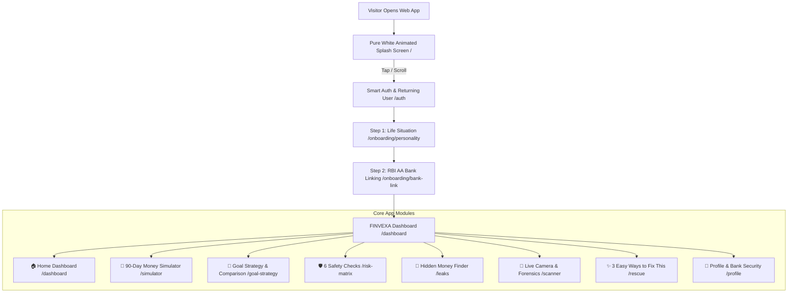

# FINVEXA 🛡️
### Universal Financial Digital Twin & Multi-Risk Decision Engine
> **"Smart Money Decisions in 8th-Grade Simple English Before You Spend a Single Rupee"**

[](https://chanakya-psi.vercel.app)
[](https://supabase.com)
[](https://fastapi.tiangolo.com)
[](https://deepmind.google/technologies/gemini/)
[](https://sahamati.org.in)

---

## 📌 Executive Summary & Problem Statement

**The Problem**: 90% of young earners, freelancers, and small shop owners in India suffer from unexpected cash shortages not because they lack income, but because:
1. **Uncertain Payment Timing**: Clients and customers promise to pay "next week", but take 22 to 25 days, while rent and worker salaries are due strictly on the 1st or 10th.
2. **Hidden Leaks & Forgotten Bills**: Sneaky 1 AM late-night delivery markups, uncredited group hangout splits, and forgotten free-trial auto-debits quietly drain ₹3,000 to ₹10,000 every month.
3. **Complex Financial Jargon**: Traditional banking apps and balance sheets speak in terms like *"Counterfactual Liquidity Deficits"* or *"Working Capital Ratios"*, confusing everyday people into making bad financial decisions or taking high-interest 36% APR loans.

**The Solution — FINVEXA**:
FINVEXA translates complex balance sheets into **8th-grade simple English**. Before buying a laptop, accepting a big client order, or taking on a project, FINVEXA simulates your real bank balance across the next 90 days. It reveals the exact day you hit a cash shortage and gives you 3 easy solutions to fix it before you spend.

---

## 🎨 Pure White & Crisp Slate High-Trust Fintech Design System

FINVEXA is styled with an official, high-trust **Pure White & Crisp Slate Theme** inspired by world-class banking interfaces (Zerodha, Stripe, and Apple Financial):
- **Backgrounds**: Crisp `bg-white` and `bg-slate-50` cards with fine grid line overlays.
- **Typography**: Dark, readable headings (`text-slate-900`) and clear body text (`text-slate-600`).
- **Card Borders**: Refined `border-slate-200` with soft `shadow-sm` depth.
- **Status Badges**: Official bank status indicators:
  - 🟢 **Safe**: Emerald Green (`#059669`)
  - 🟡 **Warning**: Amber (`#D97706`)
  - 🔴 **Alert**: Crimson Red (`#DC2626`)
  - 🔵 **Primary**: Royal Blue (`#2563EB`)

---

## 🧠 3 Real-Life Financial Personalities (8th-Grade English)

Every page, slider label, risk check, and rescue strategy dynamically re-calibrates for the chosen personality:

### 1. 🎓 Student & Job Holder
- **Real-Life Goal**: *"Buy a ₹55,000 Laptop or Bike without touching ₹18,000 Hostel Rent & College Fees."*
- **Simple Terms**:
  - `Money Safe in Bank`: ₹65,000
  - `Untouchable Rent & Fees`: ₹18,000
  - `Money Wasted on 1 AM Snacks & Subscriptions`: ₹3,400/month
  - `Friends Who Still Owe You Money`: ₹900
- **Daily Defense**: Catches 1 AM food delivery surge markups, recurring OTT app debits, and provides WhatsApp reminders for hangout splits.

### 2. 💻 Freelancer & Creator
- **Real-Life Goal**: *"Buy a ₹45,000 Camera or Editing Laptop while a client delays my ₹65,000 payment by 22 days."*
- **Simple Sliders**:
  1. `Camera/Gear Price`: ₹45,000
  2. `How Many Days Client Pays Late`: 22 Days
  3. `Advance Money Paid by Client`: 25%
  4. `Extra Tax & App Fees`: 10%
  5. `Pay in Monthly Parts`: 2 Batches
- **Risk Reality**: *"Your client sent a WhatsApp screenshot, but the money has NOT entered your bank. Studio rent of ₹15,000 is due in 10 days before the client pays. You will be short by ₹14,500 on Day 18!"*

### 3. 🏪 Small Business Owner (T-Shirt Shop)
- **Real-Life Goal**: *"Accept a ₹1,00,000 T-Shirt Order where making the shirts costs ₹60,000, delivery costs ₹5,000 extra, and ₹20,000 Staff Salaries & Shop Rent must be paid first."*
- **Simple Sliders**:
  1. `Cost to Make the T-Shirts`: ₹60,000
  2. `How Many Days Buyer Pays Late`: 25 Days
  3. `Advance Taken from Buyer`: 15%
  4. `Extra Delivery & Packing Cost`: ₹5,000 (8%)
  5. `Split Order into Batches`: 1 or 2 Batches
- **Risk Reality**: *"You have ₹50,000 in the bank, but making the shirts (₹60,000) + delivery (₹5,000) + worker salaries & rent (₹20,000) needs ₹85,000 — so you run out of money and hit a deficit of −₹35,000 on Day 18!"*

---

## ⚡ Core Features & Multi-Page Navigation



| Route | Page | What It Does in Simple English |
|---|---|---|
| `/dashboard` | **🏠 Home Dashboard** | 4 Big Plain-English KPI cards (*Money Safe in Bank*, *Untouchable Bills Locked*, *Sneaky Leaks Found*, *Safe to Spend Today*), 3D Interactive Financial Shield, and live 24/7 AI Banking Chatbot. |
| `/simulator` | **🔮 90-Day Simulator** | 3 live explanation boxes updating in real-time, white Recharts canvas with Green Expected line, Red Real-Life line, `₹0` Danger line, Untouchable Rent line, and a **"✨ Auto-Fix This Shortage Now"** button. |
| `/goal-strategy` | **🎯 Goal & Comparison** | AI Goal input box with quick chips, side-by-side comparison (*Without FINVEXA* vs. *With FINVEXA*), and genuine web-researched earning/saving platforms matched to your personality. |
| `/risk-matrix` | **🛡️ 6 Safety Checks** | 6 expandable cards showing: (1) *What AI Found in Your Account*, (2) *Why This Hurts You in Simple English*, and (3) *Actionable Fix + Web Link*. |
| `/leaks` | **💸 Hidden Money Finder** | "🎉 Public Hangout Group Bill Detected!" alert, Solo vs. Group split calculator, mobile contact picker (`navigator.contacts`), direct WhatsApp Web reminder links, and 1 AM food delivery leak reports. |
| `/scanner` | **📸 Live Camera & Forensics** | Live camera viewfinder (`navigator.mediaDevices.getUserMedia`) with green scanner frame, canvas photo capture, live GPS location geotagging (`navigator.geolocation`), and 4-point legal authenticity verification. |
| `/rescue` | **✨ 3 Easy Fixes** | 3 tailored rescue options (Advance Collection, Split Batches, Delay Purchase) with 1-click slider re-balancing and real verified tool links (*TReDS Invoicemart*, *Sahamati*, *ONDC*, *Razorpay*). |
| `/profile` | **👤 Profile & Security** | Personality switcher, RBI Account Aggregator token management, 1-click bank consent revocation, and **Hackathon Judge Reset Demo Flow button**. |

---

## 🔮 Simulator Live Explanations & Auto-Fix Engine

Above the 90-day cash curve graph, the simulator displays **3 live plain-English boxes** that change instantly as sliders move:
1. 🟢 **What You Think Will Happen**: *"You think you will finish the month with +₹35,000 profit."*
2. 🔴 **What Actually Happens in Real Life**: *"Because of late payment + hidden costs + rent/salaries due first, your bank balance hits −₹35,000 (SHORTAGE) on Day 18!"*
3. 🛡️ **How Much Advance You Need to Stay Safe**: *"Take ₹45,000 advance OR Split into 2 Batches to keep your bank balance above ₹0."*

### One-Click Auto-Fix
Right below the chart, users can tap **"✨ Auto-Fix This Shortage Now"**. With one click, the engine adjusts the advance payment slider and batches to instantly pull the Red line safely above ₹0 and the untouchable rent line!

---

## 🎯 Genuine Ways to Save & Earn Extra Money

The Goal Strategy page (`/goal-strategy`) links users to verified, real-world platforms matched to their profile:
- **For Students & Job Seekers**:
  - [Internshala Paid Internships](https://internshala.com) — ₹5,000 to ₹18,000/mo remote student stipends.
  - [Unstop Competitions & Hackathons](https://unstop.com) — Cash prize hackathons and hiring challenges.
  - [ONDC Open Network Delivery](https://ondc.org) — Direct restaurant ordering saving 25% to 30% surge markups.
- **For Freelancers & Creators**:
  - [Contra Commission-Free Freelancing](https://contra.com) — Keep 100% of client invoices with zero platform cuts.
  - [Upwork Global Projects](https://www.upwork.com) — Escrow-protected international client milestone contracts.
  - [Razorpay Milestone Payment Links](https://razorpay.com/payment-links/) — Secure 50% upfront deposits before starting work.
- **For Small Business Owners**:
  - [Invoicemart RBI TReDS](https://www.invoicemart.com) — Instant corporate invoice discounting in 48 hours.
  - [M1xchange TReDS Platform](https://www.m1xchange.com) — RBI-licensed auction platform for MSME trade bills.
  - [GeM Government e-Marketplace](https://gem.gov.in) — Direct procurement orders from Indian public sector enterprises.

---

## 📸 Working Live Camera & Forensic Verification

The Scanner (`/scanner`) features hardware-level device integration:
1. **Live Camera Viewfinder**: Calls `navigator.mediaDevices.getUserMedia({ video: { facingMode: "environment" } })` to render a 60 FPS live video stream on screen with a scanning overlay.
2. **Instant Frame Capture**: Captures the exact video frame to an HTML5 `<canvas>`, shuts down camera tracks cleanly, and displays the frozen photo preview.
3. **Verified Live GPS Location**: Calls `navigator.geolocation.getCurrentPosition` to stamp the exact latitude, longitude, and device timestamp onto the verification record.
4. **4-Point Forensic Check**:
   - `12-Digit Bank UTR Number Check`: Verifies format matches NPCI UPI protocol.
   - `Shop GSTIN Number Check`: Validates against the 15-digit state-coded GST structure.
   - `Font Pixel Editing Check`: Identifies text mismatches from fake screenshot generator apps.
   - `Hidden Delivery/Penalty Fee Check`: Uncovers hidden delivery surges or late-penalty clauses in fine print.

---

## 🔒 RBI Account Aggregator Legal Framework

FINVEXA operates strictly under the **Reserve Bank of India (RBI) Non-Banking Financial Company - Account Aggregator Directions, 2016** (Sahamati standard):
- **100% Read-Only Protected**: FINVEXA has zero capability to transfer funds or charge accounts.
- **Zero Credential Storage**: NetBanking passwords, UPI PINs, and ATM PINs are never requested or stored.
- **Cryptographic Consent Artefact**: Every link generates a unique token (e.g., `AA-RBI-2026-XXXXX`).
- **30-Day Auto-Expiry**: Consents auto-destruct on Day 30 unless renewed.
- **1-Click Instant Revoke**: Users can terminate bank access immediately from the Profile tab.

---

## 🛠️ Technology Stack & Architecture

| Layer | Technologies |
|---|---|
| **Frontend UI/UX** | React 18, TypeScript, Vite, Tailwind CSS (Pure White Fintech Tokens), Lucide Icons, Canvas API |
| **Data Visualization** | Recharts (Responsive White Grid, Multi-Axis Reference Lines, Zero Danger Line) |
| **Device APIs** | `navigator.mediaDevices.getUserMedia` (Camera), `navigator.geolocation` (GPS), `navigator.contacts` |
| **Backend API** | Python 3.11, FastAPI, Uvicorn, Pydantic v2 |
| **AI Intelligence** | Google Gemini 2.5 Flash (`google-genai` SDK), Regex Clause Parser |
| **Cloud Database & Storage** | Supabase PostgreSQL, Supabase Storage (`finvexa-documents`, `finvexa-assets`) |
| **Deployment** | Vercel (Frontend SPA), Supabase Cloud |

---

## 🚀 Quickstart & Local Setup Instructions

### 1. Clone Repository
```bash
git clone https://github.com/RAYAPURAMVIKRAM/Srujana_hackathon2026_PocketGuardAI.git
cd Srujana_hackathon2026_PocketGuardAI
```

### 2. Frontend Setup
```bash
cd frontend
npm install
npm run dev
# Frontend dev server runs on http://localhost:5173
```

To build production bundle:
```bash
npm run build
# Compiles via tsc -b && vite build to dist/
```

### 3. Backend Setup
```bash
cd backend
python -m venv venv

# Windows:
venv\Scripts\activate
# macOS/Linux:
source venv/bin/activate

pip install -r requirements.txt
python -m uvicorn main:app --host 0.0.0.0 --port 8000 --reload
# Backend API runs on http://localhost:8000 (Swagger docs at http://localhost:8000/docs)
```

---

## 👨‍⚖️ Hackathon Judge Demo Walkthrough (3 Minutes)

1. **Splash Screen (`/`)**: Note the animated FINVEXA diamond-shield logo and tap *"⬆️ Scroll Up or Tap Anywhere to Continue"*.
2. **Instant Auth (`/auth`)**: Click **"Guest"** -> **"Enter as Guest Explorer"** (or use phone number with demo OTP `8492`).
3. **Onboarding (`/onboarding/personality`)**: Pick **"Student & Job Holder"** or **"Small Business Owner"** and view how the starting numbers calibrate.
4. **Bank Safety (`/onboarding/bank-link`)**: Pick **HDFC Bank** or **SBI**, enter demo OTP `8492`, and observe the read-only Sahamati AA connection.
5. **Home Dashboard (`/dashboard`)**:
   - Inspect the 4 plain-English KPI cards.
   - Interact with the **AI Banking Chatbot** using quick prompts like *"Why was ₹250 deducted?"*.
6. **Simulator (`/simulator`)**:
   - Move the purchase slider up and watch the Red line drop into negative cash shortage on Day 18.
   - Note the **3 Plain-English Live Explanation Boxes**.
   - Tap **"✨ Auto-Fix This Shortage Now"** and see the sliders rebalance to pull the Red line into safety!
7. **Goal & Comparison (`/goal-strategy`)**:
   - View the Side-by-Side comparison table (*Without FINVEXA* vs. *With FINVEXA*).
   - Test verified external earning and saving links.
8. **Hidden Money Finder (`/leaks`)**:
   - Review the **"🎉 Public Hangout Group Bill Detected!"** card.
   - Tap **"👥 It Was a Group Split!"**, enter friend name and phone number, and test the **WhatsApp Web** reminder link.
9. **Scanner (`/scanner`)**:
   - Click **"📸 Turn On Live Camera"** to see the live viewfinder.
   - Click **"📍 Verify Live GPS Location"** to stamp your device coordinates.
   - Click **"WhatsApp Fake UPI Slip"** to see the 4-point legal authenticity report detect font tampering and missing UTR.
10. **Profile (`/profile`)**:
    - Switch to **"Small Business Owner"** to test a T-Shirt shop scenario.
    - Tap **"Reset Demo Flow"** anytime to reset local session data for the next judge!

---

## 👥 Hackathon Team & Acknowledgements
- **Team**: PocketGuardAI / FINVEXA Team
- **Hackathon**: Srujana Hackathon 2026
- **Repository**: [PocketGuardAI / FINVEXA](https://github.com/RAYAPURAMVIKRAM/Srujana_hackathon2026_PocketGuardAI)
- **Primary Remote**: `origin` (`https://github.com/RAYAPURAMVIKRAM/Srujana_hackathon2026_PocketGuardAI.git`)
- **Secondary Remote**: `chanakya` (`https://github.com/RAYAPURAMVIKRAM/chanakya.git`)
