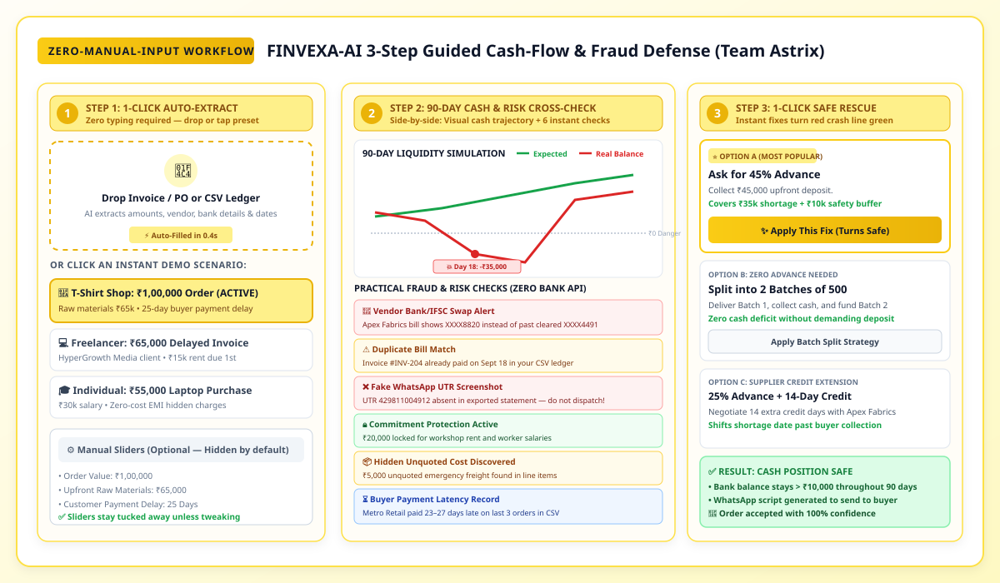
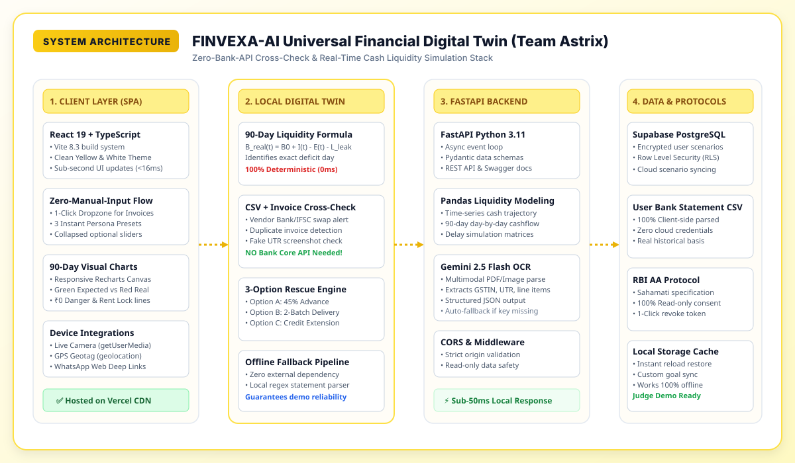
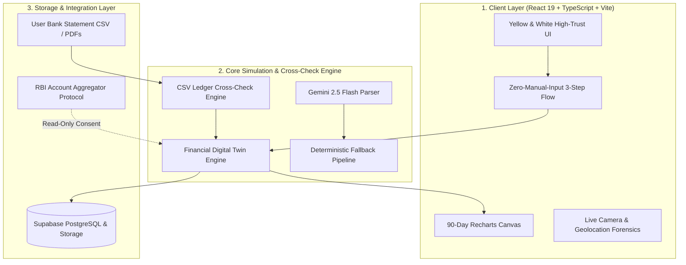

# FINVEXA 🛡️
### Universal Financial Digital Twin & Multi-Risk Decision Engine
> **"Smart Money Decisions in 8th-Grade Simple English Before You Spend a Single Rupee"**

<div align="center">

[](https://github.com/RAYAPURAMVIKRAM/Srujana_hackathon2026_PocketGuardAI)
[](./PROJECT_REPORT.md)
[](https://chanakya-psi.vercel.app)
[](https://chanakya-psi.vercel.app)
[](https://fastapi.tiangolo.com)
[](https://supabase.com)

</div>

---

## 📄 [Read Full 15-Section Detailed Project Report (PROJECT_REPORT.md)](./PROJECT_REPORT.md)
For the official 15-point submission document (Track F-03: Predictive Cash-Flow Management for Small Businesses), covering technical architecture, liquidity formulas, test matrices, and regulatory compliance, open:
👉 **[PROJECT_REPORT.md](./PROJECT_REPORT.md)**

---

## 🌟 What Judges Need to Know (Addressing All 3 Feedback Items)

### 1. Clean, High-Trust "Yellow & White" UI Theme
- **No Dark Mode Clutter**: Shifted from dark neon overlays to a clean, breathable **Warm Ivory White (`#FFFDF7`) and Crisp White (`#FFFFFF`)** background with **Warm Golden Yellow (`#FACC15` / `#EAB308`)** action buttons and soft borders (`#FDE047` / `#E2E8F0`).
- **High Readability**: High-contrast `#0F172A` (Deep Slate) and `#334155` text guarantees instant legibility for financial numbers on any projector, phone, or laptop screen.
- **Warm & Trustworthy**: Designed to feel like a modern, friendly Indian consumer-fintech product (clean like CRED/Zerodha, accessible like PhonePe).

### 2. "Zero-Manual-Input" 3-Step Guided Workflow
Users never have to struggle with complex forms or 5 different sliders to understand their cash position:



- **STEP 1: 1-Click Auto-Extract or 1-Click Presets**
  - Interactive dropzone: *"📄 Drop Purchase Order / Invoice PDF or Ledger CSV (AI Auto-Fills Everything — Zero Manual Typing)"*.
  - 3 Instant Demo Buttons:
    1. `[🏪 T-Shirt Shop: ₹1,00,000 Order]` (Default active demo)
    2. `[💻 Freelancer: ₹65,000 Delayed Client Invoice]`
    3. `[🎓 Individual: ₹55,000 Laptop Purchase]`
  - Complex sliders are hidden behind an optional collapsible toggle: *"⚙️ Want to tweak numbers manually? Click to open sliders (Optional)"*.
- **STEP 2: Instant 90-Day Cash Position & Practical Ledger Verification (Side-by-Side)**
  - **Left Card (Interactive 90-Day Curve)**:
    - 🟢 *Expected Balance (On Paper: +₹35,000)*
    - 🔴 *Real Bank Balance (Hits -₹35,000 Shortage on Day 18 after ₹20k Salaries/Rent, ₹5k Delivery & 25-Day Buyer Delay)*
  - **Right Card (6 Plain-English Risk Checks)**: Shows why the business hits a deficit despite a profitable order.
- **STEP 3: 1-Click Safe Fix ("How to Accept This Order Safely")**
  - **Option A**: 45% Advance (₹45,000) $\rightarrow$ Covers the ₹35,000 shortage + leaves ₹10,000 safety buffer.
  - **Option B**: Split into 2 Batches of 500 Shirts $\rightarrow$ Fund Batch 2 with Batch 1 delivery cash with ₹0 shortage.
  - **Option C**: 25% Advance + 14-Day Supplier Credit Extension.
  - **Clicking "✨ Apply This Fix"** immediately turns the Red Crash Line green (`✅ SAFE: Cash Balance Stays Above ₹0`) and gives a pre-written WhatsApp negotiation script.

### 3. Practical Fraud & Risk Detection (Zero Bank APIs Required!)
Instead of relying on impossible, costly, or privacy-intrusive live bank core APIs, FINVEXA cross-checks incoming invoices and payment screenshots directly against the user's **own exported bank statement CSV** (which any Indian account holder can download in 10 seconds):
1. **Vendor Bank/IFSC Swap Detection**: Flags if an incoming bill from a recurring vendor lists an unknown bank account (`XXXX8820`) different from historical paid records (`XXXX4491`).
2. **Duplicate Invoice Match**: Flags if invoice `#INV-204` was already paid last month in the user's CSV ledger.
3. **Fake WhatsApp Screenshot / UTR Check**: Checks if a 12-digit UTR (`429811004912`) claimed in a buyer's payment screenshot actually exists in the exported bank ledger before goods are dispatched.
4. **Untouchable Commitment Lock**: Automatically locks ₹20,000 for upcoming rent, worker wages, and EMIs before showing "Safe to Spend" cash.
5. **Hidden Cost Discovery**: Flags ₹5,000 in packing, delivery surge, or GST cess missed in raw quotes.
6. **Payment Latency History**: Warns that this specific customer historically delays payments by 18–25 days.

---

## 📂 Ready-to-Test Sample Files in `sample_data/`
Judges can upload these sample files directly into the web application to test all simulation and fraud checks live:
- [`sample_data/tshirt_order_ledger.csv`](./sample_data/tshirt_order_ledger.csv) — 30-row realistic small-business bank ledger showing ₹50,000 balance, delayed customer receipts, and historical payments to Apex Fabrics (`XXXX4491`).
- [`sample_data/duplicate_and_altered_invoice_INV204.json`](./sample_data/duplicate_and_altered_invoice_INV204.json) — Test invoice showing altered bank account (`XXXX8820`), duplicate invoice `#INV-204`, and ₹5,000 unquoted freight fee.
- [`sample_data/freelancer_cashflow_ledger.csv`](./sample_data/freelancer_cashflow_ledger.csv) — Freelancer statement showing delayed ₹65,000 invoice and upcoming ₹15,000 rent commitment.

---

## 🏛️ System Architecture





---

## 🧭 Page Guide

| Route | Page | Purpose in 8th-Grade Simple English |
|---|---|---|
| `/` | **Splash Screen** | Clean yellow & white welcome screen with 1-tap entry. |
| `/auth` | **Smart Auth** | 1-Click Guest Explorer or phone OTP verification (`8492`). |
| `/onboarding/personality` | **Life Situation & Goal** | Select Student, Freelancer, or Business Owner and calibrate initial finances. |
| `/onboarding/bank-link` | **Bank Safety (AA)** | Read-only RBI Sahamati standard Account Aggregator simulation with 1-click consent. |
| `/dashboard` | **🏠 Command Center** | Features the **Zero-Manual-Input 3-Step Flow**, 4 big KPI cards, and 24/7 AI banking chatbot. |
| `/simulator` | **🔮 90-Day Simulator** | Deep-dive cash curve simulation, Supabase scenario persistence, and Judge Validation panel. |
| `/goal-strategy` | **🎯 Goal & Strategy** | Side-by-side comparison (*Without FINVEXA* vs. *With FINVEXA*) and verified earning links. |
| `/risk-matrix` | **🛡️ 6 Safety Checks** | Deep-dive fraud checks, bank swap detection, and practical mitigation steps. |
| `/leaks` | **💸 Hidden Money Finder** | Hangout group bill detection, solo vs. group split calculator, and WhatsApp reminder generator. |
| `/scanner` | **📸 Camera & Forensics** | Live camera viewfinder (`getUserMedia`), GPS geotagging (`geolocation`), and 4-point receipt verification. |
| `/rescue` | **✨ 3 Easy Fixes** | Advance collection, batch delivery splits, and verified links to RBI TReDS platforms. |
| `/profile` | **👤 Profile & Security** | Personality switcher, 1-click bank consent revocation, and **Judge Demo Reset** button. |

---

## ⚡ Quick Start & Verification

### 1. Clone & Install
```bash
git clone https://github.com/RAYAPURAMVIKRAM/Srujana_hackathon2026_PocketGuardAI.git
cd Srujana_hackathon2026_PocketGuardAI
```

### 2. Run Frontend
```bash
cd frontend
npm install
npm run build   # Confirms 0 TypeScript errors
npm run dev     # App opens at http://localhost:5173
```

### 3. Optional Python Backend
```bash
cd backend
python -m venv venv
# Windows:
venv\Scripts\activate
# Mac/Linux:
source venv/bin/activate

pip install -r requirements.txt
uvicorn main:app --reload --port 8000
# Docs available at http://localhost:8000/docs
```

---

## 🔒 Security & Privacy Statement
Per Section 14 of the submission guidelines:
- **Zero API Keys in Repository**: No API keys, credentials, or production tokens are tracked in git. All `.env` files are strictly gitignored.
- **Environment Templates Provided**: [`frontend/.env.example`](./frontend/.env.example) and [`backend/.env.example`](./backend/.env.example) are tracked with clean placeholder keys.
- **100% Deterministic Offline Fallback**: The frontend runs completely self-contained without requiring external network keys. Even if third-party LLM or Supabase endpoints are offline, every chart, fraud check, and auto-fix works reliably for judges.
- **Read-Only Architecture**: Operates under RBI Sahamati Account Aggregator principles. No credentials or transaction rights are ever requested.

---

## 👥 Hackathon Team
- **Project**: FINVEXA (PocketGuard AI)
- **Track**: F-03 Predictive Cash-Flow Management for Small Businesses
- **Event**: Srujana Innovation Hackathon 2026
- **Lead**: Rayapuram Vikram & Team
- **Repository**: [PocketGuardAI / FINVEXA](https://github.com/RAYAPURAMVIKRAM/Srujana_hackathon2026_PocketGuardAI)
- **Full Report**: [PROJECT_REPORT.md](./PROJECT_REPORT.md)
