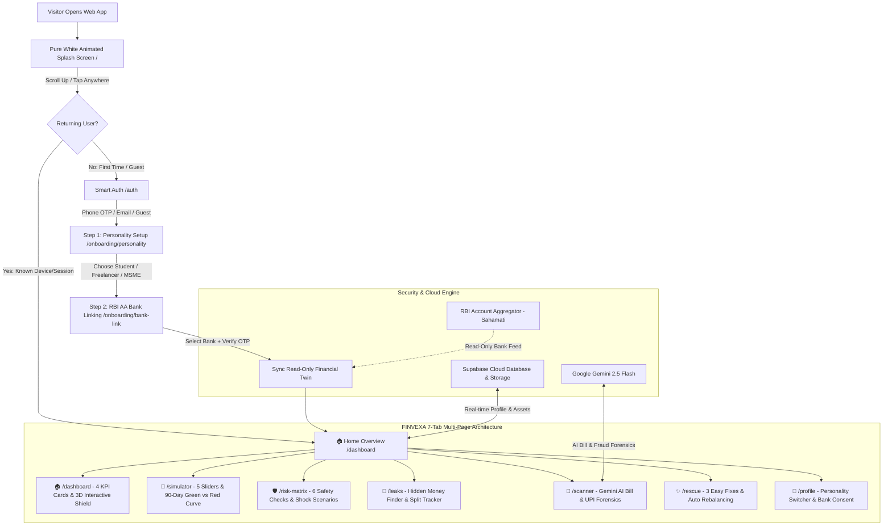

# FINVEXA 🛡️
### Universal Financial Digital Twin & Multi-Risk Decision Engine
> **"Smart Money Decisions Before You Spend"**

FINVEXA is a next-generation predictive financial digital twin and cashflow defense platform engineered for students, salaried workers, freelancers, and small business owners. Powered by 90-day Monte Carlo stress-testing, Google Gemini AI document intelligence, RBI Account Aggregator (Sahamati standard) read-only banking, and a 60 FPS interactive 3D WebGL core, FINVEXA turns complex balance sheets into 8th-grade simple, actionable financial decisions.

---

## 🏗️ Architecture & System Workflow



---

## 📱 Complete App Flow & User Experience

### 1. Pure White Animated Splash Screen (`/`)
- Sleek full-screen luminous white landing with the custom animated `<FinvexaLogo />`.
- Geometric diamond-shield with smooth Royal Blue to Emerald Green to Electric Indigo gradient.
- Animated rising pulse line converting into an upward financial arrow + glowing AI star.
- Intuitive prompt: *"⬆️ Scroll Up or Tap Anywhere to Continue"*.
- Automatically checks `localStorage` session and onboarding completion; returning users jump straight to `/dashboard`.

### 2. Smart Login & Returning User Detection (`/auth`)
- **3 Fast Entry Modes**:
  1. `📱 Phone Number` (with instant Demo OTP: `8492` helper).
  2. `✉️ Email ID` (with Password / Magic OTP).
  3. `👤 Continue as Guest` (1-click instant demo access).
- **Returning User Memory**: Automatically recognizes previous phone numbers and emails on the device, greets returning users by name, and restores their saved Personality and Bank sync without repeating onboarding.
- **Judge Bypass**: 1-click hackathon evaluation shortcut.

### 3. First-Time Setup Wizard: Personality Choice (`/onboarding/personality`)
Dedicated setup screen asking Full Name, Monthly Income estimate, and Financial Life Stage:
1. `🎓 Student & Job Holder`: Salary/pocket money, safe laptop or bike purchases, catching late-night food & subscription leaks, protecting rent & college fees.
2. `💻 Freelancer & Creator`: Handling irregular client payments, purchasing camera/studio gear safely, testing payment delays, and detecting fake UPI screenshots.
3. `🏪 Small Business Owner`: Evaluating large customer orders (e.g. ₹1,00,000 T-shirt order), protecting worker salaries & shop rent, and avoiding cash shortages.

### 4. Dedicated RBI Account Aggregator Bank Linking (`/onboarding/bank-link`)
- Built to the **Reserve Bank of India (RBI) Account Aggregator / Sahamati** standard.
- Interactive bank selection grid: `SBI`, `HDFC Bank`, `ICICI Bank`, `Axis Bank`, `Kotak Mahindra`, `Canara Bank`, or `Upload Statement Only`.
- **Bank-Grade Guarantees**:
  - 🔒 **100% Read-Only Protected**: FINVEXA has zero permission to initiate transactions or move money.
  - 🛡️ **Encrypted Connection**: End-to-end 256-bit TLS bank pipe.
  - ⏱️ **Auto-Expiry & Instant Revocation**: Consent automatically expires in 30 days or can be revoked with 1 click in Profile.
- Simulated 4-digit bank verification OTP (`8492`) with animated connection progress.

---

## 🌟 7 Multi-Page Feature Tabs

| Route | Page Name | Core Capabilities |
|---|---|---|
| `/dashboard` | **🏠 Home Overview** | 4 Big Plain-English KPI Cards (*Money Safe in Bank*, *Untouchable Bills Locked*, *Sneaky Money Leaks Found*, *Safe to Spend Today*), 3D Interactive Financial Shield, and live RBI AA status. |
| `/simulator` | **🔮 Before-You-Spend Simulator** | 5 simple sliders on the left + the 2-line 90-Day graph on the right (*Green Line: What You Think Will Happen* vs. *Red Line: Real Life After Delays & Hidden Costs*). |
| `/risk-matrix` | **🛡️ 6 Safety Checks** | Fake Screenshot & Tamper Check, Sneaky Hidden Fee discovery, Cash Shortage Date countdown, Untouchable Rent/Salary Lock, Loan Approval Score Slider, and 1-Click Emergency Economic Shocks. |
| `/leaks` | **💸 Hidden Money Finder** | Forgotten friend UPI bill splits (with 1-click WhatsApp reminders & settle buttons), pending uncredited shopping refunds, 1 AM delivery surge fee markups, and free-trial auto-debit alarms. |
| `/scanner` | **📄 AI Bill & Screenshot Scanner** | Upload any invoice, Purchase Order, or UPI transaction screenshot (or test with 3 sample receipts) for Gemini AI OCR clause extraction and fraud verification. |
| `/rescue` | **✨ 3 Easy Fixes** | 3 tailored rescue options (e.g., 40% advance, splitting payment into 3 parts, or delaying by 12 days) with a *"Fix My Plan Automatically"* button that immediately turns the Red crash line Green. |
| `/profile` | **👤 Profile & Bank Security** | Clean identity card, instant Personality switcher (switches numbers across all tabs), Linked Bank management / consent revocation, Light/Radiant-Dark theme toggle, and a **1-click Judge Demo Reset button**. |

---

## 🎨 High-Contrast Luminous Fintech Design System

- **Clean Daylight / Pearl Glass Mode**: High-contrast, clean daylight mode with crisp cards, deep slate typography, and emerald/blue accents.
- **Radiant Aurora Dark Mode**: 3-Orb ambient mesh background that dynamically matches the active financial persona:
  - **Student**: Electric Violet & Neon Cyan
  - **Freelancer**: Sunset Amber & Magma Gold
  - **Small Business**: Emerald Neon & Royal Blue
- **1-Click Theme Toggle**: Instantly switch between Daylight Pearl and Radiant Dark in the top navbar.
- **60 FPS Interactive 3D WebGL Core**: Rotating gyroscopic rings that change rotation velocity and glow color dynamically based on live cash safety.

---

## 🔒 RBI Account Aggregator Legal Framework

FINVEXA is engineered following the **Master Direction - Non-Banking Financial Company - Account Aggregator (Reserve Bank) Directions, 2016** (Updated 2023):
- **Consent Artefact ID**: Generated cryptographically on verification (`AA-RBI-2026-XXXXX`).
- **Data Minimization**: Only fetches balance and transaction history required for the 90-day cashflow digital twin.
- **No Credentials Stored**: NetBanking passwords, UPI PINs, and OTPs are never stored or requested by FINVEXA.
- **Revocability**: Users can terminate consent at any time from `/profile`.

---

## 🚀 Quickstart & Local Setup

### Prerequisites
- Node.js 18+ & npm
- Python 3.10+

### Frontend Setup
```bash
cd frontend
npm install
npm run dev
# Running on http://localhost:5173
```

### Backend Setup
```bash
cd backend
python -m venv venv
# Windows: venv\Scripts\activate | Unix: source venv/bin/activate
pip install -r requirements.txt
python -m uvicorn main:app --host 0.0.0.0 --port 8000 --reload
# Running on http://localhost:8000
```

---

## 👨‍⚖️ Hackathon Judge Demo Walkthrough (2-Minute Pitch)

1. Open the web app — notice the **Pure White Animated Splash Screen** with the custom FINVEXA diamond-shield logo.
2. Tap anywhere — click **Continue as Guest** (or enter a phone number with demo OTP `8492`).
3. On `/onboarding/personality`, pick **🎓 Student & Job Holder** and click **Next**.
4. On `/onboarding/bank-link`, choose **HDFC Bank** or **SBI**, click **Verify & Enter FINVEXA**.
5. Explore the **🏠 Home Overview**:
   - Inspect the **Safe to Spend Today** metric and touch/drag the **3D Interactive Financial Shield**.
6. Switch to **🔮 Simulator**: Move the *Laptop/Bike Price* slider up to ₹85,000 — watch the Red line plunge into cash shortage.
7. Click **✨ 3 Easy Fixes**: Hit **"Apply Plan A Automatically"** — watch the Red line immediately rise back into the Green safe zone!
8. Click **💸 Hidden Money Finder**: Send a WhatsApp split reminder to a friend for ₹400 dinner split.
9. Click your Avatar in the top right -> **Profile** -> switch to **🏪 Small Business Owner** to see the digital twin instantly reload for a shop owner fulfilling a ₹1,00,000 corporate order.
10. Click **"Reset Demo (For Judges)"** anytime to re-run the splash screen and onboarding flow.

---

## 👥 Hackathon Team & Acknowledgements
- **Project**: FINVEXA
- **Hackathon**: Srujana Hackathon 2026
- **Repository**: [PocketGuardAI / FINVEXA](https://github.com/RAYAPURAMVIKRAM/Srujana_hackathon2026_PocketGuardAI)
- **Deployment**: Vercel (Frontend) + Supabase (Cloud Database & Storage) + FastAPI / Gemini AI (Backend)
